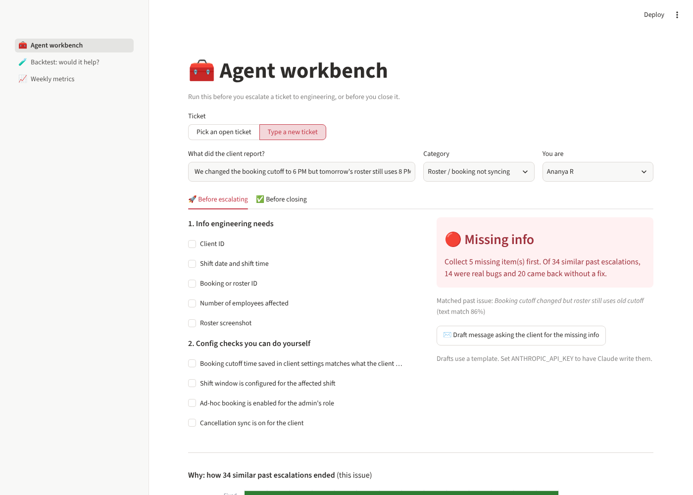

# RideOps Support: L1 Pre-Check

A working v0 for the RideOps Support case study. Open support tickets are up about 60% since July. This project finds out why from the ticket data, defines how to measure improvement week to week, and ships a small tool for **L1 support agents** that runs on the real data.



## Key findings

Full write-up: [docs/DIAGNOSIS.md](docs/DIAGNOSIS.md)

- Only **15%** of tickets genuinely needed an engineering fix.
- **19%** of tickets were escalated and returned unfixed (missing info, config, duplicate, how-to, not reproducible). They make up **47%** of all the time tickets spent open.
- These tickets bounce between L1 and engineering 2 to 3 times. Median time open goes from 13h with no escalation to 164h with 3 trips.
- Premature closes (reopens) are a smaller, separate problem: about 10% of backlog hours, concentrated in one agent.
- The fix: an L1 pre-check before escalating and before closing. No new hires needed.

## What the tool does

Design and reasoning: [docs/BUILD.md](docs/BUILD.md)

| Page | What it does |
|---|---|
| 🧰 **Agent workbench** | Your pilot queue, the 48 open CSV tickets, or a new ticket. **Before escalating:** known-issue check, then required info, then config checks, ending in 🟢 *Escalate* with a pre-filled note. **Before closing:** predicted reopen risk. Every action (escalate / fixed at L1 / linked to known issue / close) is saved to the pilot log |
| 📥 **Engineering & client inbox** | In the pilot you play engineering (verdict and "what was missing" note) and the client (confirm or reopen). Answers send tickets back to the agent's queue |
| 📝 **Checklist editor** | For the support lead: engineering's notes per category, an editor for each checklist, and *Unsorted tickets* (agents' **Other / new issue** picks) to turn into new categories |
| 📈 **Weekly metrics** | **Pilot tab:** live scorecard from the pilot log. **Baseline tab:** July–September before the tool |
| 🧪 **Backtest** | Learns from July–August, tests on September. The close check flags tickets that reopen **3.8× more often**, the known-issue match is **3.6× better than chance**, and the matcher finds the right past issue for **32 of 36** reworded tickets while calling **6 of 7** brand-new problems new. History alone *can't* predict avoidable escalations, so the tool uses a checklist. A **simulated agent** shows the checklist must catch about 78% of missing-info and config problems to reach the 30% target |

Running it as a pilot, and how it keeps learning: [docs/PILOT.md](docs/PILOT.md)

## How to run

Requires [uv](https://docs.astral.sh/uv/getting-started/installation/) (it installs Python for you).

```
uv sync
uv run streamlit run app/main.py
```

The app opens at http://localhost:8501. On the first run it downloads a small free embedding model (~70 MB, once) used to match tickets by meaning. Without internet it falls back to word matching. Pilot activity is saved in `data/pilot.db` (reset it from the inbox page).

Other commands:

```
uv run pytest                          # 12 tests
uv run python analysis/diagnosis.py    # reproduce every number in DIAGNOSIS.md
uv run python analysis/matching_eval.py  # matching accuracy: 36 reworded tickets + 7 new problems
```

**Optional:** to have Claude draft the client emails, run `uv sync --extra llm` and set `ANTHROPIC_API_KEY`. Without it, the app uses a template.

## Project structure

```
RideOps/
├── README.md
├── pyproject.toml / uv.lock   Dependencies
├── data/                      Ticket CSV and data dictionary
├── app/                       The Streamlit app and pre-check logic
│   ├── main.py                Entry point
│   ├── pages/                 Workbench, backtest, weekly metrics
│   ├── precheck.py            The escalation gate and close check
│   ├── checklists.yaml        Per-category checklists (editable without code)
│   └── ...                    data, knowledge, match, backtest, llm
├── analysis/diagnosis.py      Diagnosis numbers
├── tests/                     pytest
└── docs/
    ├── DIAGNOSIS.md           What the data says
    ├── BUILD.md               System design, tech stack, demo plan
    ├── PILOT.md               Pilot loop: logging, learning, weekly scorecard
    └── screenshots/
```

## Data

| File | What it contains |
|---|---|
| `data/rideops_support_tickets.csv` | 1,444 support tickets raised between 2 July and 30 September 2026 |
| `data/rideops_data_dictionary.csv` | Description of every column |

Data was pulled on 30 September 2026, so 48 tickets are still open. All data is fictional.

## Assumptions

- All timestamps are IST.
- A ticket is "open" if `final_closed_at` is blank as of 30 Sep 2026.
- Engineering's `eng_outcome` is treated as the truth about what a ticket really was.
- The impact estimate is a scenario (slider), not a measurement. See [docs/BUILD.md](docs/BUILD.md).
