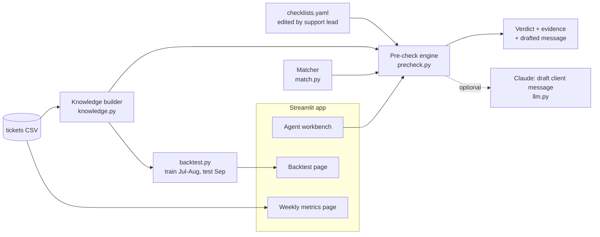

# RideOps L1 Pre-Check: System Design

Why we're building this: see [DIAGNOSIS.md](DIAGNOSIS.md). How it runs as a pilot that logs, learns and measures itself: see [PILOT.md](PILOT.md).

## The user and the job

**User:** an L1 support agent.

**Job:** before I escalate or close a ticket, tell me whether I'm about to make a mistake, and what to do instead.

The tool has two checkpoints:

| Checkpoint | Runs when | Catches | Size of the problem |
|---|---|---|---|
| **Escalation check** | Agent is about to send a ticket to engineering | Missing info, config issue, known duplicate, how-to | 47% of backlog hours |
| **Close check** | Agent is about to mark a ticket closed | Likely reopen (premature close) | ~10% of backlog hours |

## What the agent sees

**Before escalating**, the ticket goes through a short gate, in this order:

| Step | Verdict if it fails | What the tool shows |
|---|---|---|
| 1. Is it a known issue? | 🟡 **Known issue** | The existing engineering ticket to link to. Not a block, because the agent can carry on if it's clearly different |
| 2. Is the info engineering needs complete? | 🔴 **Missing info** | Checklist for this category, plus a drafted message asking the client for the missing items |
| 3. Has L1 checked the config? | 🟠 **Check config first** | The specific settings to check (e.g. booking cutoff) |
| All passed | 🟢 **Escalate** | A pre-filled escalation note |

Next to the verdict, the agent sees **evidence**: "Of 34 similar past escalations, 14 were real bugs and 20 came back without a fix", with a chart of how they ended.

**Before closing:** "High reopen risk (51%). Confirm with the client before closing." The risk combines how often this issue reopens with how often *this agent's* tickets reopen compared to what's expected.

## Architecture in plain words: follow one ticket

Think of the tool as **an experienced colleague sitting next to the L1 agent**. That colleague has read every past ticket and says: "Wait, I've seen this one before. Here's what usually happens."

**Step 1: Read the past (once, when the app starts).** The tool loads the CSV and groups past tickets by issue. For each issue it remembers what happened. Real example:

> **"Booking cutoff changed but roster still uses old cutoff"**: 66 past tickets, 34 escalated.
> Of those 34: 14 fixed by eng · 8 returned (missing info) · 7 returned (config) · 4 duplicates · 1 not reproducible.

This is the **knowledge builder** (`knowledge.py`). It's just counting, like a pivot table in Excel.

**Step 2: A new ticket comes in.** A client writes: *"We changed the booking cutoff to 6 PM but tomorrow's roster still uses 8 PM."* The agent types it into the workbench.

**Step 3: Find similar past tickets.** The wording won't match exactly, so the **matcher** (`match.py`) finds the closest past description: "Booking cutoff changed but roster still uses old cutoff" (86% match). It works like a spell-checker's "did you mean…?".

**Step 4: Run the gate.** The **pre-check engine** (`precheck.py`) takes the roster **checklist** (`checklists.yaml`) and the history from Step 1:

> 🔴 **Missing info.** Collect 5 missing item(s) first. Of 34 similar past escalations, 14 were real bugs and 20 came back without a fix.
> ☐ Client ID ☐ Shift date and time ☐ Booking or roster ID ☐ Number of employees affected ☐ Roster screenshot
> [✉️ Draft message asking the client for the missing info]

Once those boxes are ticked → 🟠 *Check config first: is the cutoff saved in client settings? Is the shift window configured?…* Once those are ticked too → 🟢 *Escalate*, with the note pre-filled.

The agent either fixes it themselves (config) or escalates **once** with everything engineering needs, so the ticket doesn't bounce.

**Close check, same idea.** When the agent closes an "ETA showing wrong" ticket, the tool says: *"21% of these reopen. Confirm with the client that tracking is correct before closing."*

## A design decision the data forced

The first design tried to **predict** which escalations were avoidable from history ("this issue is 70% avoidable, don't escalate"). The backtest showed this **doesn't work**:

| History predicted avoidable share | September escalations | Actually avoidable |
|---|---|---|
| Low (<45%) | 34 | 68% |
| Medium (45–60%) | 104 | 61% |
| High (60%+) | 51 | 49% |

The same issue is a real bug one day and a config setting the next. So the tool **does not guess and block**. Every escalation goes through the same short checklist, and the history is shown only as evidence.

Two parts *are* predictions, and the backtest shows they work (July–August → September):

| Prediction | Result on September | vs. base rate |
|---|---|---|
| **Known-issue match** | 25 flagged, 52% were real duplicates, caught 13 of 27 duplicates | 14% of escalations are duplicates, so **3.6× better** |
| **Matching reworded tickets** | Right past issue, with enough confidence to use it, for 32 of 36 client-style rewordings (89%). 6 of 7 brand-new problems correctly get *no close match* | Top match alone: meaning + words 94% vs words only 89%. Run `uv run python analysis/matching_eval.py` |
| **Close check** | Warned on 56 of 392 closes (14%). These reopened 30% of the time, caught 17 of 44 reopens | Unwarned closes reopened 8%, so **3.8× more likely** |

### Why the close check looks at the agent at all

Reopens depend on **how the ticket was closed**, not just on what the issue is, and in this data one agent produced half of September's reopens (22 of 44). So the reopen risk is *issue reopen rate × agent factor*. Without the agent factor, the close check is noticeably weaker:

| Close check uses… | Closes warned | Warned that reopened | Reopens caught |
|---|---|---|---|
| Issue only | 51 | 27% (vs 9% unwarned) | 14 of 44 |
| Issue × agent factor (4-week window) | 56 | 30% (vs 8% unwarned) | 17 of 44 |

People change, so the agent factor is designed not to stick:
- **Recent only:** it is computed from the **last 4 weeks** of each agent's tickets. An agent who starts confirming with clients drops back toward 1.0 within a month.
- **New joiners start at 1.0** (normal), and few tickets are smoothed toward 1.0, so nobody is judged on a handful of tickets.
- **It's a nudge, not a score:** it only changes the agent's own *"confirm with the client"* warning. No metric on the weekly page ranks people. The process metrics are team-level.

## Architecture diagram



### The pieces, mapped to the example

| Piece | File | In the example |
|---|---|---|
| Data loader | `app/data.py` | Opens the CSV, adds hours open, bucket and reopened flags |
| Knowledge builder | `app/knowledge.py` | "66 past tickets, 14 fixed, 7 config, 8 missing info…", plus the known-issues list and each agent's reopen factor |
| Matcher | `app/match.py` | Matched the client's wording to "Booking cutoff changed…" (fastembed meaning + RapidFuzz words) |
| Checklists | `app/checklists.yaml` | "For roster tickets: client ID, shift date…; check the cutoff setting…" |
| Pre-check engine | `app/precheck.py` | `escalation_check()` → 🔴/🟠/🟡/🟢, and `close_check()` → reopen risk |
| LLM helper (optional) | `app/llm.py` | Writes the polite "please send the roster screenshot" email. Falls back to a template without an API key |
| Backtest | `app/backtest.py` | Learns from Jul–Aug, scores on Sep |
| UI | `app/main.py` + `app/pages/` | The three pages |

### The app's three pages

1. **Agent workbench (the v0).** Pick one of the 48 open tickets or type a new one. Tick through the checklist and watch the verdict change. Switch to *Before closing* for the reopen risk.
2. **Backtest: would it help?** The results above, plus a **simulated agent**. It replays all 189 September escalations through the tool. Known-issue flags use the real measured hits. For missing-info and config problems, two sliders set how often the checklist catches the problem (the one thing the CSV can't tell us), and it runs 500 times for a range. At 50%/50%, the avoidable-escalation rate drops from 59% to about 42%, with 135 instead of 189 tickets sent to engineering. **To reach the 30% target, the checklist must catch about 78% of those problems.** That is exactly what a pilot should test.
3. **Weekly metrics.** Two things are tracked every Monday:
   - **Is the process improving?** Avoidable-escalation rate (target line at 30%), open tickets at week end, reopen rate (guardrail) and first response time.
   - **Is the tool right?** A scorecard of the tool's own hit rate per week: known-issue flags that were real duplicates, reopen warnings that really reopened, and the share of reopens it warned about. After launch, one more line gets added: of escalations that passed the full checklist, how many still came back unfixed? (Today 57%; it should fall.)

## Tech stack

| Layer | Choice | Why |
|---|---|---|
| Language | **Python 3.12+** | Fastest way to go from data to a working tool |
| Package manager | **uv** | One command installs everything and runs the app |
| Data | **Polars** | Modern, fast DataFrames with clean expression syntax |
| Matching | **fastembed** (BAAI/bge-small-en-v1.5) + **RapidFuzz** | Score = half meaning, half shared words. The embedding model is free, ~70 MB, runs on CPU and is downloaded once. Meaning finds rewordings ("transport never arrived" → "Cab did not turn up"), and words keep exact details ("booking cutoff" vs "cancelled bookings"). Falls back to words only if the model can't load |
| UI | **Streamlit** (`st.navigation` multipage) | Interactive browser app in pure Python, with no separate frontend |
| Charts | **Altair** | Declarative charts in a few lines |
| Config | **YAML** | Checklists a non-engineer can edit |
| LLM (optional) | **Anthropic SDK** | Only for drafting client messages, and off unless `ANTHROPIC_API_KEY` is set |
| Tests | **pytest** | 12 tests on the gate order, matching (incl. different wordings), close check, backtest, the pilot loop and new categories |
| Hosting | **Streamlit Community Cloud** | Free, deploys from a GitHub repo, and gives a link for the submission email |

**Deliberately not used:** a React frontend plus API (twice the code for no demo value), a database (the CSV is the source of truth for v0), embeddings or a vector database (overkill for about 200 distinct descriptions), and ML classifiers (the backtest shows history can't separate avoidable from real bugs, so a model would only hide that).

## Folder layout

```
RideOps/
├── README.md               Overview and how to run
├── pyproject.toml          Dependencies (uv)
├── uv.lock                 Exact versions
├── data/                   Ticket CSV + data dictionary
├── app/
│   ├── main.py             Streamlit entry point (navigation)
│   ├── pages/
│   │   ├── workbench.py        Agent workbench (the v0)
│   │   ├── backtest_page.py    Would it have helped?
│   │   └── weekly_metrics.py   Success measure
│   ├── data.py             Load CSV + derived fields
│   ├── knowledge.py        Step 1: count what happened to past tickets
│   ├── match.py            Step 3: "did you mean…?"
│   ├── precheck.py         Step 4: the escalation gate and close check
│   ├── checklists.yaml     Per-category checklists (editable)
│   ├── backtest.py         Train Jul–Aug, test Sep
│   ├── llm.py              Optional Claude-drafted client message
│   ├── store.py            Pilot log (SQLite): tickets, escalations, closes
│   ├── pilot_metrics.py    Live pilot scorecard
│   ├── baseline_view.py    Baseline tab of weekly metrics
│   └── ui.py               Cached loaders for the pages
├── analysis/diagnosis.py   Reproduces every number in DIAGNOSIS.md
├── tests/test_precheck.py
└── docs/
    ├── DIAGNOSIS.md
    ├── BUILD.md            This file
    └── screenshots/
```

## Demo plan (15 minutes)

| Time | What to show |
|---|---|
| 0–3 min | **The problem:** the bucket table in DIAGNOSIS.md. Only 15% of tickets needed engineering, while bouncing tickets cause 47% of the backlog |
| 3–8 min | **Workbench, new ticket:** type the booking-cutoff ticket. It shows 🔴 Missing info and drafts the client email. Tick the boxes to get 🟠 Check config, then 🟢 Escalate with a pre-filled note |
| 8–9 min | **Workbench, known issue:** "Scheduled report email not received" gets 🟡, pointing to the existing engineering ticket |
| 9–10 min | **Close check:** a GPS ticket owned by Karan B shows high reopen risk, and why |
| 10–13 min | **Backtest:** the close check is 3.8× and the known-issue match 3.6× better than chance. Then the honest part: history *can't* predict avoidable escalations, so the tool gates instead of guessing. Move the simulated-agent sliders: "to hit 30% the checklist must catch ~78%; that's what the pilot tests" |
| 13–15 min | **Weekly metrics,** and what we'd do in the next 4 weeks |

## Success measure (tracked weekly on page 3)

- **Primary:** avoidable-escalation rate, meaning the share of escalations returned without a fix. Baseline 57% overall, 55% in the last full week. Target below 30%.
- **Outcome:** open tickets at week end. Baseline 48 at the data pull.
- **Guardrail:** reopen rate (baseline 10.5%) must not go up.
- **Guardrail:** real bugs must still reach engineering. Watch the share of escalations that are *Fixed*; the gate should raise it, not lower it.

## Assumptions and limits

- Historical `eng_outcome` is treated as the truth about what a ticket really was.
- The impact estimate assumes a prevented escalation closes at L1 in 11 hours (the L1 median). How often the checklist actually catches a problem can only be measured in a pilot, which is why the simulation takes it as a slider.
- **How to measure it for real (pilot):** put 2–3 agents on the tool for 2 weeks while the others work as today. Compare the share of each group's escalations that come back unfixed. If the tool group drops toward 30% while the other group stays near 55%, the tool works. The gap between the groups is its real effect.
- Ticket descriptions are one line. A real deployment would read the full ticket thread.
- The checklists were written from the categories and outcomes in the data, not from talking to engineers. Validating them is week 1 of the plan.
- The v0 reads a CSV. A real version would plug into the helpdesk (e.g. as a sidebar app in Freshdesk or Zendesk).
