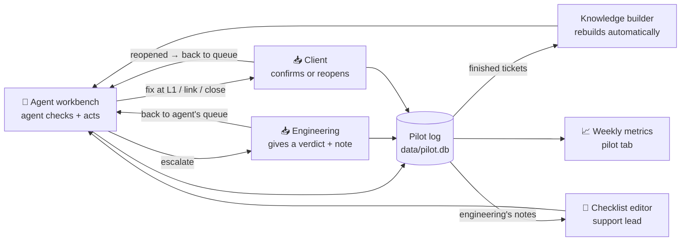

# Running the Pre-Check as a Pilot

The v0 only *read* the CSV. The pilot version **records what happens** when agents use it, **learns from the results**, and **measures itself every week**. You can run the whole loop on your laptop today, playing the agent, engineering and the client yourself.

## The loop in one picture



Every arrow is something that happens in the app today.

## What gets saved (the pilot log)

One SQLite file, `data/pilot.db`, with three tables:

| Table | One row per… | Key columns | Why we need it |
|---|---|---|---|
| `tickets` | pilot ticket | category, description, client, agent, **status** | Where each ticket is right now |
| `escalations` | each time L1 sends a ticket to engineering | what the tool said, **how many checklist boxes were ticked**, engineering's **verdict** and **note** | Tells us whether escalations through the checklist still come back |
| `closes` | each time L1 closes a ticket | how it was closed (normal / fixed at L1 / linked to known issue), **predicted reopen risk**, **did the client reopen?** | Tells us whether "fixed at L1" fixes hold and whether reopen warnings are right |

A ticket's **status** moves like this:

```
New ──escalate──▶ With engineering ──verdict──▶ Back from engineering ──close──▶ Closed ──client reopens──▶ Reopened
 │                                                    │                                                    │
 └── fix at L1 / link known issue / close ──▶ Closed ◀┘ (or escalate again) ◀──────────── agent works it again ┘
```

## How it keeps itself up to date

| What | How it updates | Who | When |
|---|---|---|---|
| **Knowledge** (how similar tickets ended, reopen rates, known issues) | Rebuilt automatically from the CSV **plus every finished pilot ticket**. No button needed | Nobody, it's automatic | Every time something is logged |
| **Checklists** | Engineering writes *"what was missing"* when returning a ticket. The support lead sees those notes per category in the **Checklist editor** and turns repeated ones into new items | Support lead | Weekly, about 15 min |
| **Categories** | An agent picks **Other / new issue** when nothing fits. The support lead sees those in **Checklist editor → Unsorted tickets**, and when 3+ describe the same problem clicks **Create category**. It appears in the agent's dropdown straight away | Support lead | Weekly, with the checklist review |
| **Weekly metrics** | Calculated straight from the pilot log | Automatic | Live, reviewed every Monday |
| **Thresholds** (e.g. warn at 15% reopen risk) | Re-run the backtest on the latest month and check the hit rates still beat chance | Engineer who owns the tool | Monthly |

**Example of the checklist loop:** engineering returns three roster tickets in a week with the note *"cutoff was saved as 8 PM in client settings"*. The support lead adds *"Screenshot of the cutoff time in client settings"* to the roster checklist. From the next ticket on, every agent is asked for it before escalating.

### When a ticket is something the tool has never seen

| Situation | What the tool does |
|---|---|
| New wording, known category (e.g. a roster problem phrased in a new way) | The best match scores below 65, so it falls back to how the **whole category** usually ends. Once the ticket is finished it becomes history, so the next similar one gets a direct match |
| A new kind of problem (e.g. *"SOS button doesn't alert security"*) | The agent picks **Other / new issue**. The tool says *"No history yet, follow the basic checklist"* (client ID, trip ID, time, screenshot) and shows the average reopen risk. It does not pretend to know |
| The same new problem keeps coming | The support lead creates a category from the unsorted list and moves those tickets into it. It starts with the basic checklist and gets sharper from engineering's notes, the same as every other category |

| Agents word the same problem differently (*"ads in the app"*, *"Ads showing in app"*) | Within a category, past tickets scoring at least 80 (half meaning via a small embedding model, half shared words) count as **the same issue**, so their history adds up. Deliberately strict: *"marked not boarded"* and *"didn't get the OTP"* score 79 and are different bugs, so a few rewordings of one problem can stay separate |
| L1 keeps fixing it without engineering | Once 2+ similar tickets (and at least half) were closed at L1 and stayed closed, the verdict becomes **🔵 Try fixing at L1**, with engineering's last note for the category. If the fix doesn't work, completing the checklist still turns it 🟢 *Escalate* |

A person decides when something becomes a category, and the tool only gathers the evidence (how many unsorted tickets read alike). That stops one odd ticket from creating a category, and it stops new problems from being mixed into the wrong category's history.

## The pilot scorecard (Weekly metrics → Pilot tab)

**1. Is the problem shrinking?**

| Metric | Meaning | Baseline | Pilot goal |
|---|---|---|---|
| 🎯 Escalations returned unfixed | Of escalations engineering has answered, the share sent back without a fix | 57% | toward 30% |
| Escalations avoided | Tickets fixed at L1 or linked to a known issue, *never* sent to engineering | 0 | grows |
| 🛡️ Reopen rate | Of closes the client answered, the share they reopened | 10.5% | must not rise |

**2. Is the tool right?**

| Metric | Meaning | What good looks like |
|---|---|---|
| Checklist complete → still returned | Every box was ticked, yet engineering returned it. **The direct test of the checklist** | Far below 57%. If it stays high, the checklist is asking the wrong questions, so fix it in the editor |
| "Fixed at L1" that stayed fixed | When the agent fixed it instead of escalating, did the client confirm? | 90%+. Lower means agents are closing tickets that needed engineering |
| Reopen warnings that reopened | Of warned closes, how many came back | Well above the ~8% for unwarned closes (backtest: 30%) |

## Try it yourself (10 minutes, you play everyone)

1. `uv run streamlit run app/main.py`, and in the sidebar, *You are: Me (pilot agent)*.
2. **Agent workbench → New ticket.** Keep the booking-cutoff example. Tick all the boxes until it shows 🟢, then click **🚀 Escalate to engineering**.
3. **Engineering & client inbox → Engineering.** Pick *Config issue – returned to L1* and type a note: *cutoff was saved as 8 PM*. Save.
4. **Workbench → My pilot queue.** The ticket is back with engineering's note. Click **🛠️ I fixed it at L1**.
5. **Inbox → Client.** Click **👍 Client confirms it's fixed**.
6. **Workbench → Open tickets from the CSV.** Pick a GPS ticket, go to *Before closing* (it warns), and click **✅ Close ticket**. In the inbox, click **↩️ Client reopens it**.
7. **Weekly metrics → Pilot tab.** Every number reflects what you just did. **Checklist editor → Roster** shows engineering's note as a candidate checklist item.
8. **New kind of ticket:** in *New ticket*, type *SOS button doesn't alert security* and pick **Other / new issue**, then escalate it. In **Checklist editor → Unsorted tickets**, tick it, name it *SOS / panic button* and click **Create category**. Back in the workbench it's in the dropdown.
9. Start over any time: **Inbox → Full pilot log → Reset**.

## Running the real pilot (2 weeks)

- **Who:** 2–3 agents use the workbench. The rest work as today (the control group).
- **Compare weekly:** escalations returned unfixed, *tool group vs control group*. The gap is the tool's real effect, separate from a busy or quiet week.
- **Pass criteria after 2 weeks:**
  - tool group's escalations returned unfixed ≤ 35% (control around 55%)
  - "fixed at L1" held ≥ 90%
  - reopen rate not above control
- **If it passes:** roll out to all 8 agents and keep the Monday review.

## From pilot to production: what changes

| Pilot (today) | Production |
|---|---|
| SQLite file on one laptop | Postgres (e.g. managed on Supabase or RDS). Set `RIDEOPS_DB`, same three tables |
| You play engineering and the client in the inbox | Helpdesk webhooks: the engineering ticket's resolution and the client's reply/reopen write to the log automatically |
| "You are" dropdown | Helpdesk login (each agent sees their own queue) |
| Separate Streamlit app | Same logic as a sidebar app inside the helpdesk (Freshdesk / Zendesk), so agents don't switch windows |
| Checklist YAML edited in the app | Same, plus a change history so you can see which edit moved the numbers |

**Deliberately not in the pilot:** auto-closing or auto-escalating tickets (the tool advises, the agent decides), and ML models (the backtest showed history can't predict avoidable escalations).
